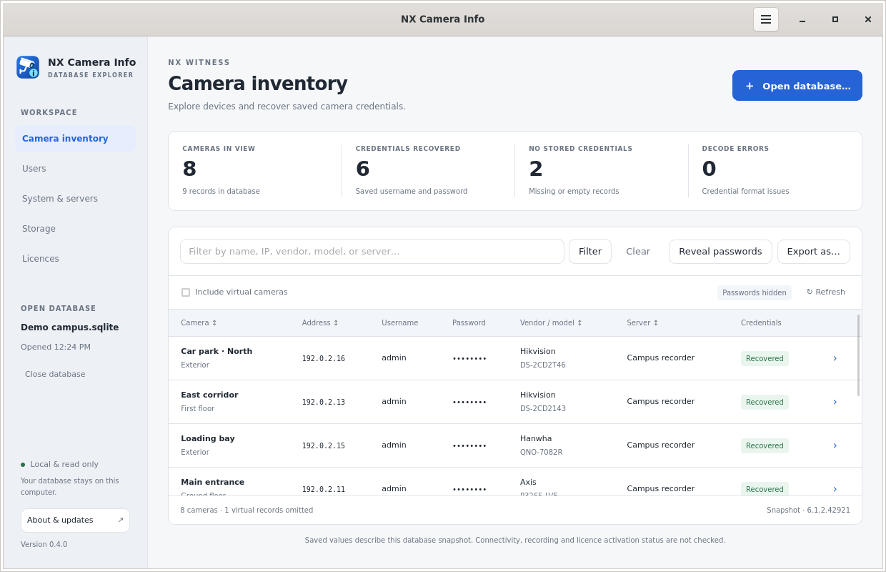

<p align="center"></p>

# NX Camera Info

A desktop GUI and standalone command-line tool for listing camera information and recovering saved camera credentials from an Nx Witness `ecs.sqlite` database. Both run on Linux, Windows, and macOS, on Intel/AMD 64-bit and ARM64. Neither requires Nx Powertoys, Python, an installed SQLite command, or a running Nx server.

## Desktop GUI

The Wails v3 desktop application provides native Open/Save dialogs and menus, system light/dark appearance, and platform-adapted controls. Open a database, filter the camera list, reveal or hide passwords, inspect device details, and export the current view as CSV or JSON.



Get the installers from [release v0.3.1](https://github.com/TerminalAddict/nx-camera-info/releases/tag/v0.3.1). See the [GUI installation and usage guide](docs/GUI.md) for dependencies, screenshots, keyboard shortcuts, and build instructions.

The [project branding](docs/BRANDING.md) uses the same CCTV/info icon throughout the app, desktop launchers, and installers.

**About & updates** shows the version, platform, and a short introduction to creator [Paul Willard](https://paulwillard.nz/). Check GitHub for a newer release and download the matching installer inside the app, with progress and SHA-256 verification. After downloading, quit the app and run the installer. See [About and updates](docs/GUI.md#about-and-updates) for details.

| System | GUI installer / package |
| --- | --- |
| Linux Intel/AMD 64-bit | `nx-camera-info-gui-0.3.1-linux-amd64.deb`, `.rpm`, or `.tar.gz` |
| Linux ARM64 | `nx-camera-info-gui-0.3.1-linux-arm64.deb`, `.rpm`, or `.tar.gz` |
| Windows Intel/AMD 64-bit | `nx-camera-info-gui-0.3.1-windows-amd64-setup.exe` |
| Windows ARM64 | `nx-camera-info-gui-0.3.1-windows-arm64-setup.exe` |
| macOS Intel | `nx-camera-info-gui-0.3.1-macos-amd64.pkg` or `.dmg` |
| macOS Apple Silicon | `nx-camera-info-gui-0.3.1-macos-arm64.pkg` or `.dmg` |

Windows installers include Microsoft's full offline WebView2 installer. Linux DEB/RPM packages declare GTK4/WebKitGTK dependencies for the package manager to install; the archive includes a dependency-install script. macOS uses the built-in WebKit framework. These builds are not publisher-signed or Apple-notarized; see the guide for first-launch instructions.

## Command-line downloads

Get the executable for your computer from the [latest release](https://github.com/TerminalAddict/nx-camera-info/releases/latest):

| System | Executable |
| --- | --- |
| Linux Intel/AMD 64-bit | `nx-camera-info-linux-amd64` |
| Linux ARM64 | `nx-camera-info-linux-arm64` |
| Windows Intel/AMD 64-bit | `nx-camera-info-windows-amd64.exe` |
| Windows ARM64 | `nx-camera-info-windows-arm64.exe` |
| macOS Intel | `nx-camera-info-macos-amd64` |
| macOS Apple Silicon | `nx-camera-info-macos-arm64` |

Download `THIRD_PARTY_NOTICES.txt` alongside the executable. `SHA256SUMS` contains checksums for the release files. The macOS binaries are not Developer ID-signed or notarized.

On Windows, open PowerShell in the download directory:

```powershell
.\nx-camera-info-windows-amd64.exe --help
.\nx-camera-info-windows-amd64.exe --db "C:\Camera backups\ecs.sqlite"
.\nx-camera-info-windows-amd64.exe --db "C:\Camera backups\ecs.sqlite" --show-passwords --format csv --output camera-export.csv
```

Use the `windows-arm64.exe` executable instead on Windows ARM64. Exported files inherit Windows directory permissions; choose a private directory when exporting passwords.

On an Apple Silicon Mac, open Terminal in the download directory:

```sh
chmod +x ./nx-camera-info-macos-arm64
./nx-camera-info-macos-arm64 --help
./nx-camera-info-macos-arm64 --db "$HOME/Camera backups/ecs.sqlite"
```

Use `nx-camera-info-macos-amd64` instead on an Intel Mac. On Windows and macOS, the default database is `ecs.sqlite` in the current directory; use `--db` to select another file. A consistent database backup copied from your Nx server can be read on either system.

## Run

From this directory:

```sh
# Camera inventory, with passwords masked.
./dist/nx-camera-info --db ecs.sqlite

# Show saved camera usernames and passwords.
./dist/nx-camera-info --db ecs.sqlite --show-passwords

# Export all available camera details, including passwords.
./dist/nx-camera-info --db ecs.sqlite --show-passwords --format csv --output camera-export.csv
./dist/nx-camera-info --db ecs.sqlite --show-passwords --format json --output camera-export.json

# Match a name, IP/hostname, UUID, vendor, model, MAC, group, logical ID or server.
./dist/nx-camera-info --db ecs.sqlite --filter Hikvision --show-passwords

# Counts only; include desktop camera records when needed.
./dist/nx-camera-info --db ecs.sqlite --summary
./dist/nx-camera-info --db ecs.sqlite --include-virtual --summary --format json
```

On Linux, the default database path is `/opt/networkoptix/mediaserver/var/ecs.sqlite`. Use `--db ecs.sqlite` to read the copy in the current directory, as in the examples above. There is no automatic fallback from the Linux server path to a local file.

`--help` (or `-h`) explains every option and includes usage examples without requiring a database. If the selected database does not exist, the tool shows the attempted path, guidance for `--db`, and the full help text, then exits with code `1`. All options also accept a single leading dash.

Copy `dist/nx-camera-info` (or the downloaded `nx-camera-info-linux-amd64`, renamed to `nx-camera-info`) to an x86-64 Linux Nx server and use the default database path:

```sh
chmod +x ./nx-camera-info
./nx-camera-info --help
sudo ./nx-camera-info --show-passwords
```

That path is the standard Network Optix Linux location; OEM installations may differ. `sudo` is only needed if your account cannot read the database. This is a separate shell executable, not a command registered inside Nx Witness.

## Output

The table shows name, host, username, password, vendor, model, assigned server, and credential recovery status. JSON and CSV also contain:

- Camera UUID, parsed IP address, URL port, original device URL, MAC, serial number, firmware, physical ID, logical ID and group.
- Server UUID, display name, URL and Nx version.
- Stored HTTP/media ports, ONVIF device URL, stream URLs and driver class.
- Stored status code, recording schedule flag and audio flag, where present.
- Credential source, password-presence flag, decode errors and metadata warnings.

`host` may be an IP address or hostname. `ip` is populated only when the saved host is a literal IP; the program does not perform DNS lookups. `port` comes from the URL or its scheme's default. `http_port` and `media_port` are the stored override properties, which can be empty.

Passwords are masked by default. The masked view also removes URL userinfo, query strings and fragments; unusual unparseable URLs are suppressed. URL paths remain visible. `--show-passwords` reveals passwords and complete URLs. A blank password with `has_password: false` is distinct from a missing credential record or a decode error. CSV preserves exact field values; use a text-aware import if opening it in spreadsheet software.

`--output` creates a new file and refuses to overwrite an existing file or symlink. On Linux and macOS it uses Unix permissions `0600`; on Windows it inherits the destination directory's permissions. Shell redirection uses your shell's permissions instead. JSON has `summary` and `cameras` members; summary-only JSON contains just the summary object. Command diagnostics go to stderr, leaving stdout suitable for piping.

Exit codes: `0` successful read (including no matches or missing credentials); `1` argument, database or output error; `2` results emitted but at least one selected camera's credentials could not be decoded.

## Findings from the supplied database

- SQLite integrity check passed.
- 36 camera records: 31 network camera/RTSP records and 5 virtual desktop records.
- Two server records, both reporting Nx Witness `6.1.2.42921`.
- Effective stored credentials recovered for all 31 network camera records: 20 use `credentials`, and 11 fall back to `defaultCredentials`.
- All 38 stored credential fields decoded structurally: 20 explicit and 18 default entries. Seven cameras have both fields; the explicit field takes precedence.

These are saved credentials from this database snapshot. They have not been tested against the cameras, and the saved device addresses or passwords may have changed. The program makes no network connections and does not alter camera or Nx configuration. Virtual desktop records are omitted unless `--include-virtual` is supplied.

## Database and format support

The tool joins `vms_camera` to `vms_resource`, user attributes, server records and status records, and reads a selected set of camera properties from `vms_kvpair`. It opens SQLite with `mode=ro` and `query_only`, and reads within one transaction. It does not use `immutable=1`, so committed changes in an existing WAL are respected. SQLite may create or use shared-memory sidecars for a WAL database even when the database connection is read-only.

For an offline copy, use an Nx database backup or a consistent SQLite backup. Copying only `ecs.sqlite` while the server is writing can omit committed data in `ecs.sqlite-wal`. Do not remove active WAL/SHM files. Opening the live database requires appropriate access to any sidecars as well as the database file.

Credential fields in the tested database are hex-encoded AES-128-CBC with the fixed key and IV in Network Optix's published source and zero-byte padding. The decoded data is `username:password`, split at the first colon. The implementation rejects invalid lengths, padding and UTF-8 rather than presenting undecodable bytes as a password. This format has no cryptographic authentication; structural validation does not prove a password is current or that the database has not been altered.

An explicit `credentials` property takes precedence even if empty or undecodable. Only an absent property falls back to `defaultCredentials`, matching Nx's published camera logic. Conflicting duplicate properties fail with an error. These are camera credentials; this program does not recover Nx user account passwords from account hashes or dump server authentication keys.

Tested against the supplied Nx 6.1.2 schema. Other versions may use compatible tables, but are not claimed as tested. Unsupported schema or credential formats produce explicit errors. Stored status codes and schedule flags describe the snapshot, not live reachability or proof of current recording.

Format and schema references:

- [Network Optix's AES encoding implementation](https://github.com/networkoptix/nx_open/blob/96b23e2661065723711bc00bb7e7cceade3acb0d/libs/nx_utils/src/nx/utils/crypt/symmetrical.cpp).
- [Network Optix's camera credential selection and parsing](https://github.com/networkoptix/nx_open/blob/96b23e2661065723711bc00bb7e7cceade3acb0d/vms/libs/nx_vms_common/src/core/resource/camera_resource.cpp).
- [Network Optix's database documentation](https://support.networkoptix.com/hc/en-us/articles/115013837268-Media-Server-Database-Files).
- [Nx Powertoys camera password feature](https://nxpt.io/).

## CLI build and test

Requires Go 1.26 or later to build. The SQLite dependency is pinned in `go.mod` and `go.sum`; the first build may download dependencies. The compiled CLI uses Go's AES implementation and a pure-Go SQLite driver, so no separate OpenSSL or SQLite installation is needed. All CLI targets disable CGO; the Linux CLI executables are statically linked, while Windows and macOS use standard system libraries. For the desktop application's native dependencies and build instructions, see the [GUI guide](docs/GUI.md#build-and-validate).

The Makefile targets run in a Unix-style shell with Make (the `release` target also needs `sha256sum`):

```sh
make build           # dist/nx-camera-info for this machine (.exe on Windows)
make check           # go vet and race-enabled tests
make linux-amd64     # dist/nx-camera-info-linux-amd64
make linux-arm64     # dist/nx-camera-info-linux-arm64
make windows-amd64   # dist/nx-camera-info-windows-amd64.exe
make windows-arm64   # dist/nx-camera-info-windows-arm64.exe
make macos-amd64     # dist/nx-camera-info-macos-amd64
make macos-arm64     # dist/nx-camera-info-macos-arm64
make release         # all six platforms, notices, and SHA256SUMS
```

To build natively in Windows PowerShell without Make:

```powershell
$env:CGO_ENABLED = "0"
go build -trimpath -ldflags="-s -w" -o dist/nx-camera-info.exe .
Copy-Item THIRD_PARTY_NOTICES.txt dist/
go test ./...
```

Tests use synthetic data and independently generated OpenSSL test vectors. They cover credential precedence, Unicode and colon-containing passwords, corrupt formats, masked URLs, read-only enforcement, committed WAL reads, filename URI escaping, metadata joins, filters, CSV/JSON, output permissions and overwrite refusal. User databases and exported credentials are excluded from Git.

GitHub Actions runs vet, tests, and executable help/version checks on Linux, Windows, and macOS for AMD64 and ARM64, plus race-enabled tests on Linux and macOS. Release binaries can be cross-compiled on Linux with `make release`.

Initial Linux validation against the supplied database recovered 31 effective credential pairs matching an independent OpenSSL decoding check; CSV and JSON exports agreed, and the original database's SHA-256 remained unchanged. No actual camera login or remote Nx server execution was attempted.

Third-party notices are included in `THIRD_PARTY_NOTICES.txt` and copied into `dist/` by the build targets. Keep them with redistributed binaries.
