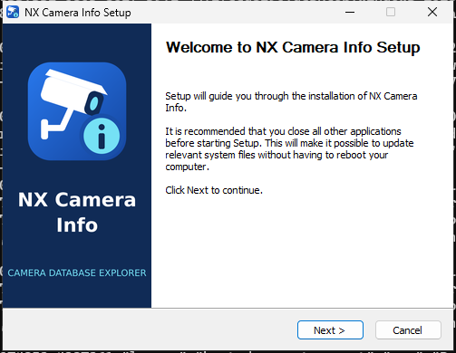

# NX Camera Info branding

A white CCTV camera represents the saved camera inventory. The cyan **i** badge represents camera information. The blue tile keeps the icon recognizable on light and dark desktops. The mark is original vector artwork; it contains no Network Optix logo or third-party stock imagery.

The source is [branding/icon.svg](../branding/icon.svg). Edit this file, then run `make branding` to regenerate the derived assets. This requires Python 3, librsvg's `rsvg-convert`, ImageMagick 7, and DejaVu Sans for installer lettering. The checked-in assets let normal app builds run without these design tools.

| Surface | Asset / integration |
| --- | --- |
| Project README and documentation | SVG source and PNG previews |
| App sidebar, empty state and favicon | Generated `frontend/icon.svg` |
| Native About dialog and runtime app icon | Embedded `packaging/icon.png` |
| Windows executable, title bar, taskbar and shortcuts | Multi-resolution `packaging/icon.ico`, embedded at Wails resource ID 3 |
| Windows setup and uninstaller | Same ICO, branded welcome/finish sidebar and page headers |
| Linux launcher and application switching | Desktop entry matched to the GTK program name; scalable SVG and 16–512 px hicolor icons |
| macOS Finder, Dock and application switching | `AppIcon.icns`, including Retina images up to 1024 px |
| macOS PKG installer | Branded introduction with the app icon |
| Mounted macOS DMG | Custom volume icon and branded app bundle |

Colors: blue `#2878ed` → `#15459e`, navy `#102b56`, cyan `#75e1f5`, and white. Keep the camera, support arm, information badge, and transparent outer margin together when using the app icon.

The installer files retain the operating system's normal package-file appearance where that is controlled by the OS. The branding is applied to the installer UI, installed application and desktop integration.

## Windows installer

This is the actual setup window captured during the native Windows release checks. The same mark is embedded in the setup executable, installed application, and uninstaller.

