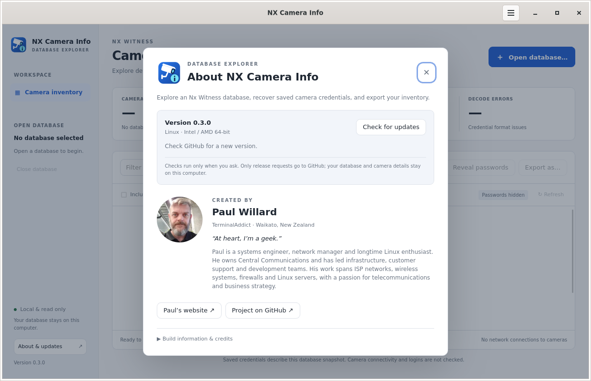
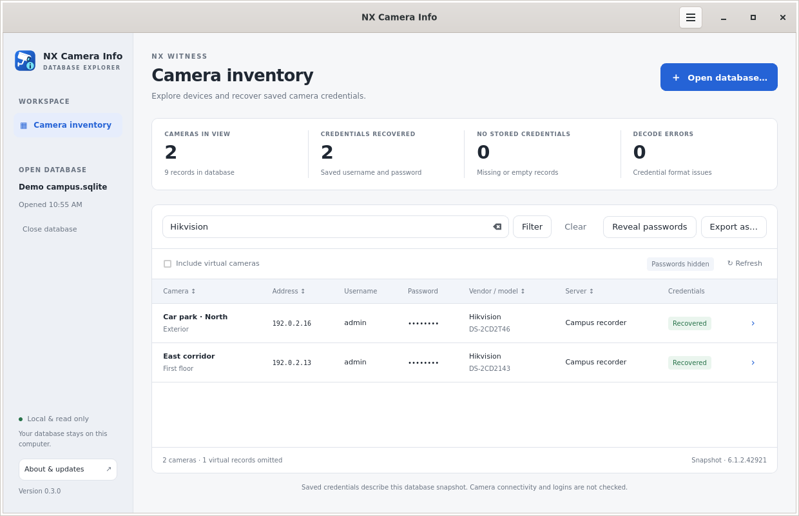
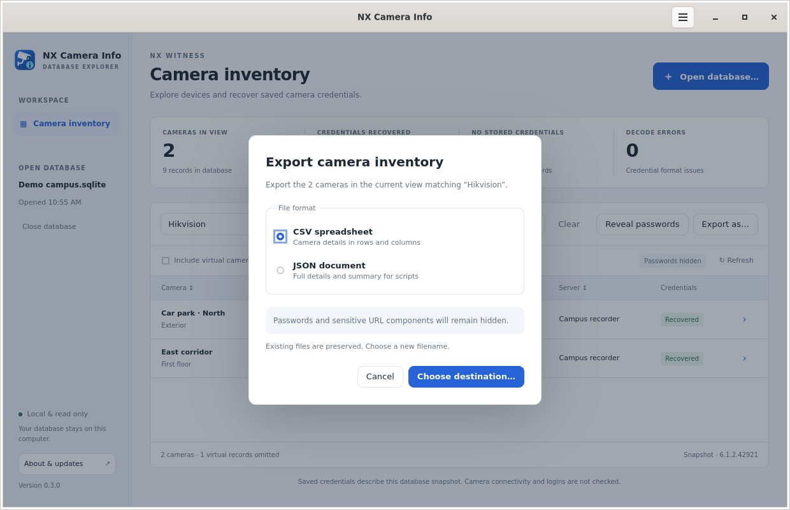
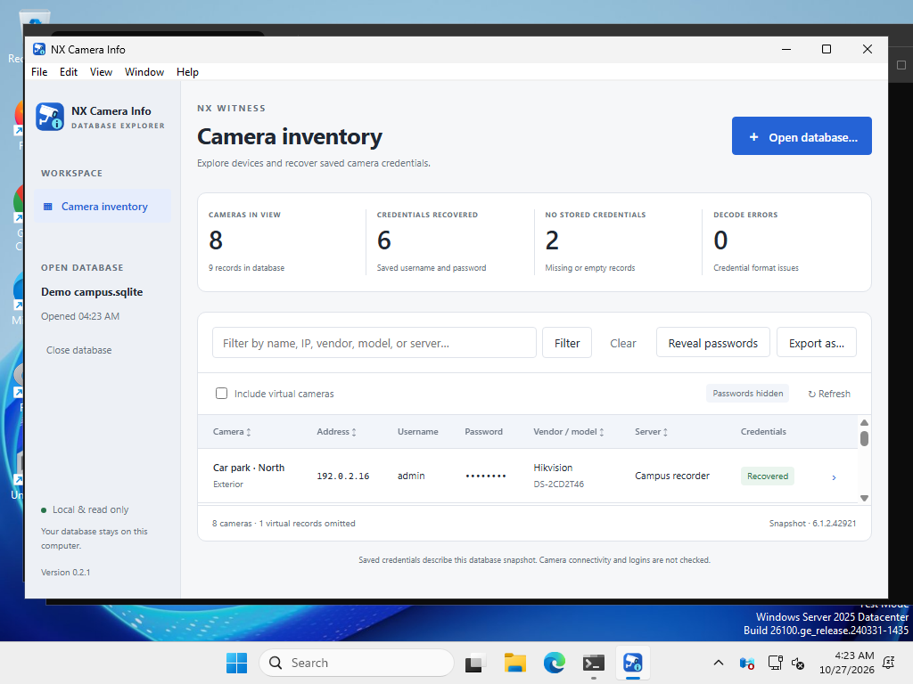
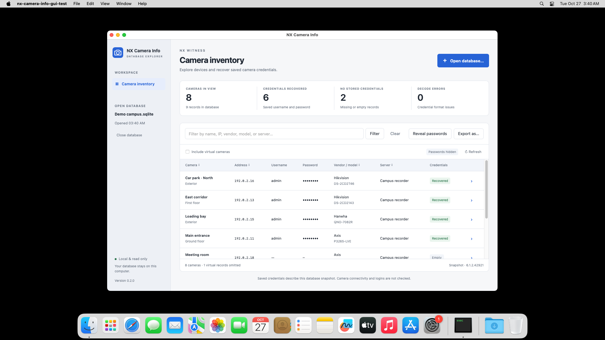

# NX Camera Info desktop GUI

The desktop application uses Wails v3 with GTK4/WebKitGTK 6.0 on Linux, WebView2 on Windows, and the system WebKit view on macOS. It shares the same database reader, credential decoder, masking rules, and export formats as the CLI.

The CCTV camera and information badge appear in the app, desktop icons and installers. See the [branding guide](BRANDING.md) for the artwork and platform integration.

## Install

Download the package for your operating system and processor from [v0.3.0](https://github.com/TerminalAddict/nx-camera-info/releases/tag/v0.3.0). `amd64` means Intel/AMD 64-bit; `arm64` means Windows/Linux ARM64 or Apple Silicon. Check downloads against `SHA256SUMS`.

### Windows 10/11

Run the matching `windows-amd64-setup.exe` or `windows-arm64-setup.exe`. Setup installs under your user account, creates Start menu and desktop shortcuts, and provides an uninstaller in Windows Settings.

The installer contains Microsoft's **full Evergreen Standalone WebView2 Runtime installer** for the selected architecture. It detects an existing runtime and installs the included runtime when missing, so installation does not need a runtime download. The Microsoft payload's Authenticode signature is checked during packaging. WebView2 subsequently receives Microsoft's normal updates; uninstalling NX Camera Info leaves this shared runtime installed.

The application and its installer are not publisher-signed. Windows may display a SmartScreen warning. Use **More info → Run anyway** only after verifying that you downloaded this release from this repository and checking its checksum. Organization policies may require an administrator to approve unsigned applications.

### macOS

Choose the `macos-amd64` installer for Intel Macs or `macos-arm64` for Apple Silicon. Run the `.pkg` installer to install into `/Applications`, or open the `.dmg` and drag **NX Camera Info** to Applications. WebKit is included with macOS; no additional runtime, Go, or Node.js installation is needed.

These bundles have a local ad-hoc signature for executable integrity, but no Apple Developer ID signature or notarization. If macOS blocks opening the downloaded app or installer, use **System Settings → Privacy & Security → Open Anyway**, after verifying its source and checksum. A managed Mac may require administrator approval. Do not disable Gatekeeper globally.

The bundles require macOS 12 or later, matching the [Go 1.26 runtime requirement](https://go.dev/wiki/MinimumRequirements#macos-n%C3%A9e-os-x-aka-darwin). Native release validation uses macOS 15 on Intel and Apple Silicon. Earlier macOS versions are not covered by that test matrix.

### Linux

Use a graphical desktop on Ubuntu 24.04+, Debian 13+, Fedora 40+, or a compatible recent distribution with **glibc 2.39+, GTK 4.14+, and WebKitGTK 6.0**. Packages are available for AMD64 and ARM64. Ubuntu 22.04, Debian 12, and distributions providing only WebKitGTK 4.1 are not supported by these GUI builds; the CLI remains available separately.

For Ubuntu/Debian, install the DEB with APT so missing dependencies are resolved:

```sh
sudo apt install ./nx-camera-info-gui-0.3.0-linux-amd64.deb
```

For Fedora, install the RPM with DNF:

```sh
sudo dnf install ./nx-camera-info-gui-0.3.0-linux-amd64.rpm
```

Replace `amd64` with `arm64` when appropriate. These packages declare GTK4, WebKitGTK 6.0, and desktop portal dependencies. **Installing missing Linux dependencies requires internet access to your distribution repositories.** System libraries are not bundled into the DEB/RPM; the package manager maintains their updates.

For the archive, extract into its own directory:

```sh
mkdir nx-camera-info-gui
tar -xzf nx-camera-info-gui-0.3.0-linux-amd64.tar.gz -C nx-camera-info-gui
cd nx-camera-info-gui
./install.sh
nx-camera-info-gui
```

The script supports APT, DNF, and Pacman. It installs the application under `/opt/nx-camera-info`, adds a desktop-menu entry, and installs an application-specific AppArmor profile when needed. The DEB also installs this profile so WebKit's own user-namespace sandbox can start on Ubuntu 24.04; no global sandbox restrictions are disabled. The archive has the same library requirements as the packages; it is not a fully static or universally portable build. Run the GUI as your normal desktop user. Use a readable database backup when the live server database requires elevated access.

## Use

1. Click **Open database…** and select an Nx Witness `ecs.sqlite` database or a consistent backup. The operating system's file chooser is used. Canceling leaves the current database open; an invalid file displays an error without discarding the previous view.
2. Enter a name, address, vendor, model, UUID, MAC address, group, logical ID, or server in **Filter** and press Enter or click **Filter**. **Clear** removes the filter. Click column headings to sort the displayed table.
3. Click **Reveal passwords** to display recovered credentials and complete URLs; **Hide passwords** masks them again. Opening another database always starts masked. No credentials are written to application preferences or a browser store.
4. Click a row's **›** button or double-click the row to inspect device metadata, URLs, credential source, and decode errors.
5. Select **Include virtual cameras** to include desktop camera records. The summary counts reflect the current view.
6. Click **Export as…**, choose CSV or JSON, and select a destination using the native Save dialog. The export uses the applied filter, virtual-camera setting, and password visibility shown in the export dialog. Merely typing a new filter does not change an export until that filter has been applied. Existing files are never overwritten.
7. **Refresh** rereads the database. Otherwise, filtering, reveal/hide, and exports all operate on the same loaded snapshot. **Close database** clears the snapshot from the session.

Passwords are masked by default, including URL user information, query strings, and fragments. Revealed exports contain saved credentials: keep them in a private location. Export files use `0600` on Linux/macOS and inherit directory permissions on Windows. CSV values are preserved exactly; use a text-aware spreadsheet import for untrusted device fields.

The application does not contact cameras, test logins, modify camera configuration, or alter database contents. SQLite may use WAL/SHM sidecars when opening a database with committed WAL data. Follow the [database backup guidance](../README.md#database-and-format-support) when copying a running server's database.

## About and updates

Open **About & updates** in the sidebar or **Help → About NX Camera Info**. On macOS, **NX Camera Info → About NX Camera Info** opens the same page. It shows the installed version, OS/CPU, build details, and an introduction to creator [Paul Willard](https://paulwillard.nz/). The biography and portrait are available offline.

Click **Check for updates**, or use **Help → Check for Updates…**, to query this project's latest stable GitHub release. Checks are manual. No database contents, filenames, camera information, or credentials are sent to GitHub. The request includes the app version in its user agent; GitHub sees normal connection information such as your IP address.

When a newer version is available:

1. Choose a package for your current OS and CPU. Linux offers DEB, RPM, and tar.gz when published; macOS offers PKG and DMG; Windows offers its matching setup EXE.
2. Click **Download update…** and choose a destination in the native Save dialog. The app downloads the installer with progress and cancellation, then verifies its size and SHA-256 against GitHub's release metadata. Existing files are preserved; failed or cancelled downloads are removed.
3. Click **Show downloaded installer**, quit NX Camera Info, then run the installer. On Linux, use APT/DNF as shown above, or extract the archive and run `install.sh`; on macOS, run the PKG or drag the app from the DMG into Applications. Relaunch and check the version.

This is an in-app download with installation completed by the platform installer. It does not silently replace the running app or bypass operating-system installation prompts. If no verified matching package is available, the About page offers the release page. Offline and rate-limit errors can be retried. Version 0.2.1 and earlier require one manual download of 0.3.0 to gain this feature.



## Screenshots

These are captures of the running GUI with a generated **synthetic** database. Camera names, addresses in the documentation-only `192.0.2.0/24` range, and credentials are demonstration data.

### Camera inventory — Linux GTK4


### Filtered camera inventory



### Export options



### Windows — WebView2



### macOS — system WebKit



The Windows and macOS captures come from native CI desktops. The macOS menu identifies the test executable; installed bundles display **NX Camera Info**.

### Windows installer


## Keyboard and desktop integration

| Action | Windows/Linux | macOS |
| --- | --- | --- |
| Open database | Ctrl+O | Command+O |
| Export | Ctrl+E | Command+E |
| Focus filter | Ctrl+F | Command+F |
| Refresh database | Ctrl+R | Command+R |
| Close database | Ctrl+Shift+W | Command+Shift+W |
| Quit | Ctrl+Q | Command+Q |

Menus, window controls, Open/Save dialogs, browser links, and revealing downloaded installers use Wails' native platform integration. The About page, camera table, and controls use platform-adapted HTML/CSS with system fonts, keyboard focus indicators, and system light/dark appearance. Linux uses a GTK header-bar menu, Windows a menu bar, and macOS the application menu.

## Build and validate

Requires Go 1.26+, a platform C toolchain where needed, and the [Wails v3 platform dependencies](https://wails.io/quick-start/installation/). There is no npm build step; the frontend assets are embedded directly into the Go executable.

On Linux, install `libgtk-4-dev libwebkitgtk-6.0-dev`, then:

```sh
make check
make gui
./dist/nx-camera-info-gui
```

On macOS install Xcode command-line tools first; `make gui` creates the executable, and `bash scripts/package-macos.sh` creates the app bundle, PKG and DMG. On Windows, generate the resources with `go run ./cmd/windows-resource amd64` (or `arm64`), then build with `go build -tags gui,production -ldflags="-s -w -H windowsgui" -o dist/nx-camera-info-gui.exe .`.

The [GUI workflow](../.github/workflows/gui.yml) builds on native runners for all six targets, launches the actual system WebView, and exercises open/cancel, masked rendering, reveal/hide, camera details, filtering, virtual cameras, refresh, CSV/JSON export, overwrite refusal, invalid database handling, and close. It also checks the About page, portrait, version, links, current/new release states, offline errors, download cancellation, checksum failure, retry, and saving/revealing a verified download. Native dialog selections, external browser/file-manager launches, and GitHub HTTP responses are substituted in these automated tests; the real Go services, updater, file writes, Wails bridge, rendered controls, and SQLite reader are exercised. The synthetic update payload is never executed. Installer checks verify installation of the DEB, Windows setup, and macOS PKG; RPM installation is checked in Fedora containers. The test harness is excluded from release binaries. The production Linux build was also checked through the real native Open and Save dialogs, including a masked CSV export.

For a local native Linux UI test and fresh screenshots:

```sh
make gui-test
NX_GUI_TEST_DIR="$(mktemp -d)" xvfb-run -a -s '-screen 0 1280x900x24' \
  dbus-run-session -- ./dist/nx-camera-info-gui-test
```

This needs Xvfb and ImageMagick. The directory receives screenshots, a JSON result, and synthetic export/database files. To generate a standalone sample database for manual testing:

```sh
go run ./cmd/demo-database /tmp/demo-camera-database.sqlite
```

The release also includes `demo-camera-database.sqlite` for trying the GUI without a server database. It contains eight fictional cameras and one virtual camera, with demonstration credentials only.

Packaging scripts live in `scripts/package-*.sh` and `scripts/package-windows.ps1`. Windows builds download and verify Microsoft's offline runtime. Linux builds use `dpkg-deb` and `rpmbuild`; macOS builds use the system `pkgbuild` and `hdiutil`. Keep both third-party notices files with redistributed GUI binaries.
